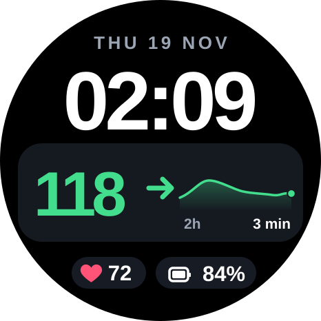

# Libre Compact Face — Amazfit Active 2 Round

A separate **second watch face** modeled on the supplied compact large-time design.
The existing diagnostic face in `watchface/` is unchanged and can remain
installed. This project has its own watchface identity (provisional appId
`1092843`) so it does not replace the original face (appId `1092842`).

## Design target

The illustration is the **visual goal**, not an actual watch screenshot.
The time, glucose, graph, heart rate and battery are example values.
The watchface stays read-only and never generates demo glucose values.
The two-hour graph starts immediately after the native trend arrow and
uses true timestamps: if there are fewer than two hours of measurements,
the uncovered left area remains empty instead of inventing history.

**Reading age:** `5 min` on this watchface means the current glucose
measurement is five minutes old. It tracks the same Libre measurement timestamp
as the Mini App's `LIVE 5m` label, *not* the latest repaint, graph fetch,
or shared-storage publication. Minor differences may occur when the two
screens are checked at different times.

## Display

- Large time (HH:MM) with a short English weekday/date above it.
- Black background and rounded dark glucose panel.
- Current glucose in mg/dL, native trend arrow, fixed **2h sparkline** and
  measurement age. Colors use the same thresholds the Mini App publishes.
- Small heart-rate and battery pills; no diagnostics or developer controls.
- Separate minimal AOD scene with time, glucose and reading age.

**No demo readings or synthetic graph points.** If no valid shared reading
is available the face shows `--` and a storage-state code. Above 15 minutes it shows
`STALE Xm` and dims the value. History gaps longer than 11 minutes are
not joined by a chart line. BPM shows `--` until the wearing sensor has
reported confirmed wearing for 60 seconds and at least two fresh heart-rate
events have occurred. The watch's wearing sensor may misclassify off-wrist
status: BPM is experimental.

## Connection to Libre Monitor

The **existing** Mini App (appId `1092841`) remains the only
LibreLinkUp client and publishes the glucose snapshot using Zepp
`ShareTypedStorage("libre-glucose-face-v1")`. This face reads that same
snapshot using `TypedStorage(1092841, "libre-glucose-face-v1")`.
No credentials, pairing, new service, or network access are added.

The Mini App must be installed from this branch, not an older `main`
build: previous versions of the app do not publish any cross-app glucose data.
After preview-installing the Mini App from the **repository root**, open it
and press **Refresh**. Then reactivate the compact face.

The publisher now writes a small `reading` record separately from the
full `snapshot` history. This allows the face to display the latest real
glucose even if the larger history cannot be stored/read. The graph only
appears when real history is available.

If glucose is unavailable, the age field briefly acts as a connection
diagnostic: `NO SHARE` means no shared records found (check the installed
Mini App version), `BAD SHARE` means shared data exists but failed validation,
and `READ ERROR` means storage access threw an error. None of these means
that LibreLinkUp itself has no glucose.

The background service must actually succeed at refreshing the shared
snapshot for glucose to update while the Mini App is closed. The watchface
polls shared storage every 30 seconds while awake and on minute/resume
events. Zepp OS may suspend updates while the screen is asleep.

## Preview installation

1. Switch to branch `feat/compact-glucose-watchface` in the Codespace.
2. From the **repository root**, run `npm install && npm run preview` and
   scan the first Zepp QR. This updates **Libre Monitor** (appId `1092841`),
   which is the data publisher. Do not skip this step even if Libre Monitor
   already displays glucose.
3. Open Libre Monitor on the watch and press **Refresh**. Confirm live glucose;
   use `BG ON` for future background updates.
4. Return to the root folder, then run
   `cd watchface-compact && npm install && npm run check && npm test && npm run preview`.
5. Scan the **second QR** to update **Libre Compact Face** (appId `1092843`).
   The order matters: publisher first, reader second.
6. Activate the compact face and verify the age field shows `Xm` rather
   than `NO SHARE`. The installed original diagnostic face is unchanged.

**Important:** `1092843` is an unverified/provisional watchface appId.
Zepp may require a separate appId registered to your developer account;
if preview rejects it, change only `watchface-compact/app.json`. Do not
change the Mini App's `1092841` publisher identity.

The chart is intentionally fixed to 2h to match the design. Its history
still comes from the existing six-hour publisher, independently of the
Mini App's selected chart range.

## Real-watch test checklist

1. Verify time, day, battery and the entire rounded layout fit the Active 2.
2. Compare glucose, arrow and measurement age to Libre Monitor / LibreLinkUp.
3. Close Libre Monitor and recheck after 5–15 minutes, including a screen wake.
4. Test while off-wrist: the heart pill should become `--`. A displayed
   BPM despite off-wrist means the system's wear detection is unreliable.
5. Try Always-On Display set to **Follow current watch face**, where available.
   If the OS selects a system standby face, it cannot be overridden by this
   project; custom AOD behavior requires verification on the actual watch.

Experimental non-medical glucose display; do not use it for CGM alarms,
insulin dosing or safety-critical decisions. Keep official alerts enabled.
